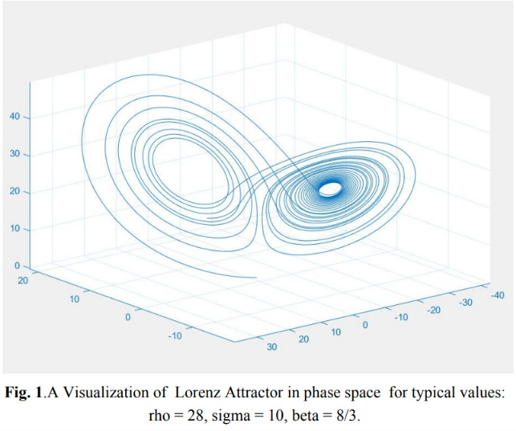

# Numerical Solution for Lorenz Equations & Malkus–Lorenz Waterwheel

A project report exploring numerical ODE integration of the **Lorenz system** and its physical derivation via the **Malkus–Lorenz waterwheel**.

## Overview

The **Lorenz system** is a three-dimensional, nonlinear, deterministic set of ordinary differential equations exhibiting sensitive dependence on initial conditions (chaos):

$$\frac{dx}{dt} = \sigma(y - x)$$

$$\frac{dy}{dt} = x(\rho - z) - y$$

$$\frac{dz}{dt} = xy - \beta z$$

For classic chaotic parameters $\sigma = 10$, $\rho = 28$, and $\beta = \frac{8}{3}$, trajectories trace out the Lorenz attractor in phase space. The report also derives the governing equations of motion for a **Malkus–Lorenz waterwheel** (via mass continuity, rotational torque balance, and Fourier amplitude modes) and shows how a change of variables maps the waterwheel dynamics onto the Lorenz equations.

## Lorenz Attractor Visualization



## Key Results & Findings

* **Numerical Simulation of Chaotic Trajectories**: Using MATLAB's `ode45` solver on the coupled Lorenz ODEs with $\sigma = 10$, $\rho = 28$, and $\beta = \frac{8}{3}$ produces the classic 3D phase-space attractor (butterfly / figure-eight trajectory).
* **Sensitivity to Initial Conditions & Step Size**: Because the system is nonlinear, deterministic, and chaotic, small differences in initial conditions or numerical step size ($h$) can lead to diverging trajectories over time. Choosing $h$ involves a practical trade-off between numerical accuracy and computation time, bounded by machine precision limits.
* **Malkus–Lorenz Waterwheel Derivation**: By applying conservation of mass (continuity equation), rotational torque balance (including damping and gravitational torque), and a Fourier series expansion of mass distribution $m(\theta, t)$ and inflow $Q(\theta)$, the waterwheel dynamics reduce to a coupled set of ODEs.
* **Equivalence to the Lorenz System**: Under a change of variables relating angular velocity $\omega$ and Fourier modes $(a_1, b_1)$ to $(x, y, z)$, the waterwheel model maps onto the Lorenz system with $\sigma = \pi$, $\rho = \frac{\pi g r q_1}{\nu \dots}$ (as formulated in the report's parameter mapping), and $\beta = 1$, showing that the waterwheel is a special case of the broader Lorenz equations.
* **Physical Intuition for Chaos**: Mechanical systems such as the Malkus–Lorenz waterwheel—reversing rotation direction unpredictably over time scales of seconds—provide intuitive physical insight into deterministic chaos.

> **Note:** In the report's Section III(D) (*Change of variables*), a couple of symbols have minor typographical/OCR artifacts in the PDF text (such as `0` vs. `\theta`, `v` vs. `\nu`, and a partially garbled time/parameter expression). Double-check those exact expressions against your original equation sheet before finalizing.

## Repository Structure

```text
malkus-lorenz-waterwheel-simulation/
├── README.md                      # Project summary, key results, equations, and usage instructions
├── Math202-ProjectReport.pdf      # Original Math202 project report
├── lorenz.m                       # ODE solver wrapper and 3D attractor plot
├── lorenz_rhs.m                   # Right-hand side ODE evaluations
├── lorenz_attractor.png           # Attractor plot from the report
└── .gitignore                     # Ignores MATLAB autosaves and OS files
```

## Usage in MATLAB

With the files in the repository root, run in MATLAB:

```matlab
[x, y, z] = lorenz(28, 10, 8/3);
```
